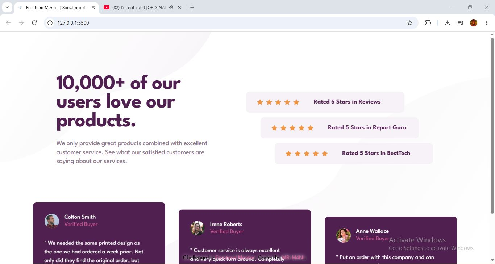
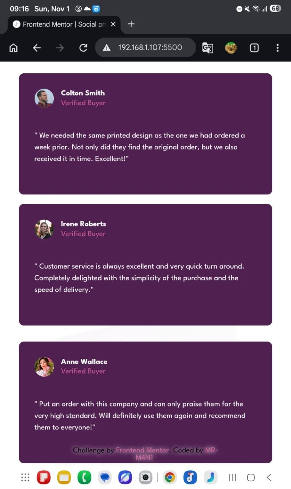
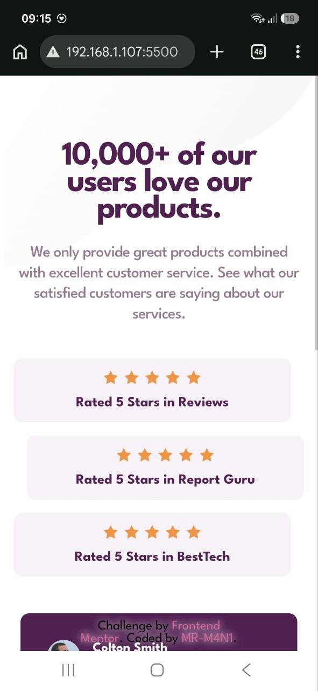
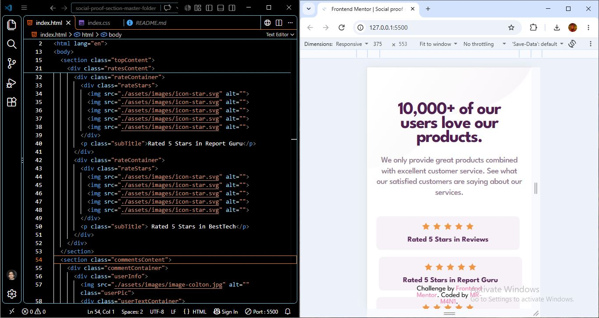

# Social-proof-section
This is a my solution to the Social proof section challenge on Frontend Mentor
# Frontend Mentor - Social proof section solution

This is a solution to the [Social proof section challenge on Frontend Mentor](https://www.frontendmentor.io/challenges/social-proof-section-6e0qTv_bA). Frontend Mentor challenges help you improve your coding skills by building realistic projects. 

## Table of contents

- [Overview](#overview)
  - [The challenge](#the-challenge)
  - [Screenshot](#screenshot)
  - [Links](#links)
- [My process](#my-process)
  - [Built with](#built-with)
  - [What I learned](#what-i-learned)
  - [Continued development](#continued-development)
  - [Useful resources](#useful-resources)
  - [AI Collaboration](#ai-collaboration)
- [Author](#author)
- [Acknowledgments](#acknowledgments)

## Overview

### The challenge

Users should be able to:

- View the optimal layout for the section depending on their device's screen size

### Screenshot





### Links

- Solution URL: [Add solution URL here](https://your-solution-url.com)
- Live Site URL: [Add live site URL here](https://your-live-site-url.com)

## My process



### Links

- Solution URL: [Frontend Mentor Solution]([https://github.com/MR-M4N1/Ping-coming-soon-page](https://github.com/MR-M4N1/Social-proof-section.git))
- Live Site URL: [Live Demo]([https://mr-m4n1.github.io/Ping-coming-soon-page/](https://mr-m4n1.github.io/Social-proof-section/))


### Built with

- Semantic HTML5
- CSS3
- Flexbox
- CSS Custom Properties (Variables)
- CSS Animations (@keyframes)
- Responsive Design (Media Queries)
- Google Fonts (League Spartan)

### What I learned

1. Creating animations with @keyframes

I learned how to define custom animations using @keyframes and control the movement of elements over time.

```css
@keyframes floatingX1 {
    0%, 100% {
        transform: translateX(-10px);
    }
    50% {
        transform: translateX(10px);
    }
}
```

2. Applying animations with the animation property

I learned how to apply different animations to individual elements and customize their duration and behavior.

```css
.rateContainer:first-child {
    animation: floatingX1 4s ease-in-out infinite;
}
```

### Continued development

I plan to improve my CSS animation skills and explore more advanced responsive design techniques.

### Useful resources

- [ColorZilla](https://chromewebstore.google.com/detail/colorzilla/bhlhnicpbhignbdhedgjhgdocnmhomnp?hl=en) - A useful browser extension for picking colors directly from web pages and identifying color codes. It helped me find and match colors from the provided design.

### AI Collaboration

I used ChatGPT to review my HTML and CSS, debug issues, understand CSS concepts, and explore different implementation approaches.

AI feedback helped me improve my code and strengthen my understanding, although I always made the final implementation decisions myself.

## Author

- Frontend Mentor - [@MR-M4N1](https://www.frontendmentor.io/profile/MR-M4N1)
- Pinterest - [@MR-M4N1](https://www.pinterest.com/mrm4n1/?invite_code=4dc73b0e43814c3395c2f9600625eb5d&sender=1093671228168293050)
- LinkedIn - [@mani-ghorbanian](https://www.linkedin.com/in/mani-ghorbanian-351820327/)

## Acknowledgments

Thanks to Frontend Mentor for providing this challenge and the design resources that helped guide my implementation.
